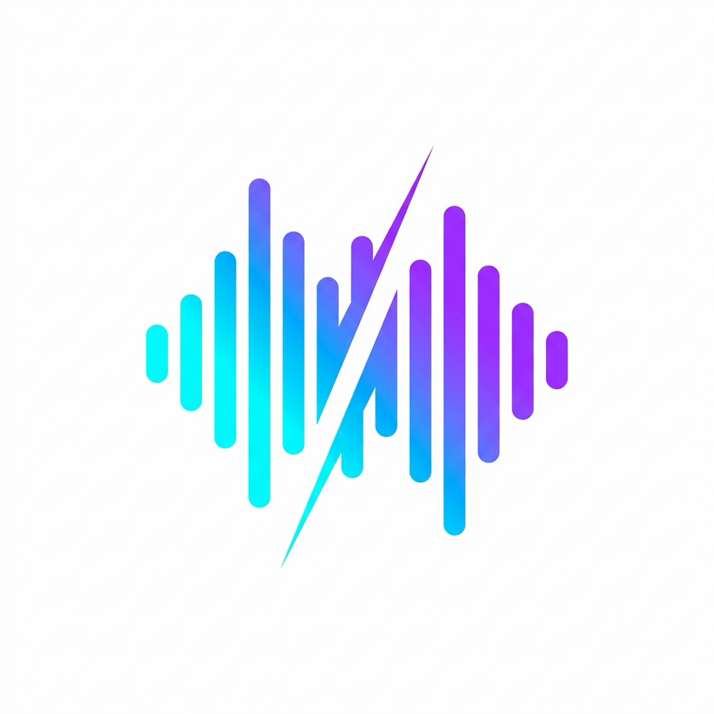

<p align="center">
  
</p>

<h1 align="center">Audio Splitter for macOS</h1>

<p align="center">
  A clean, lightweight, and blazingly fast macOS application to split audio files using Apple's native <b>AVFoundation</b>.
</p>

<p align="center">
  
  
  
  
</p>

---

## 🌟 Features (ฟีเจอร์เด่น)

- ⚡ **Native AVFoundation Engine**: ประมวลผลและตัดไฟล์เสียงด้วย Apple AVFoundation รวดเร็วทันใจ ไม่สูญเสียคุณภาพเสียง และประหยัดพลังงาน
- 🎯 **Flexible Splitting Modes (เลือกโหมดการแบ่งได้ 2 แบบ)**:
  - **Equal Parts**: แบ่งไฟล์เสียงออกเป็น *N* ส่วนเท่าๆ กันโดยอัตโนมัติ
  - **Fixed Duration**: แบ่งไฟล์เสียงตามระยะเวลาที่กำหนด (เช่น ตัดทุกๆ 5 นาที)
- 🔁 **Smart Overlap**: กำหนดช่วงเวลาเหลื่อมทับซ้อน (Overlap) ได้ เพื่อป้องกันไม่ให้คำพูดหรือท่อนเพลงขาดหายตรงจุดตัด
- 📂 **Drag & Drop & Batch**: ลากไฟล์ `.m4a` หลายไฟล์เข้ามาวางในแอปได้ทันที
- 📁 **Custom Output Directory**: กำหนดโฟลเดอร์ปลายทางสำหรับบันทึกไฟล์ได้ตามสะดวก
- 📊 **Real-time Progress**: มีแถบแสดงสถานะและเปอร์เซ็นต์ความคืบหน้าระหว่างการตัดไฟล์

---

## 📥 Download & Installation (ดาวน์โหลดและติดตั้ง)

### 1. ดาวน์โหลด
ไปที่หน้า [**Releases**](../../releases) บน GitHub แล้วดาวน์โหลดไฟล์ตัวติดตั้ง:
```
Audio_Splitter_Installer.dmg
```

### 2. การติดตั้ง
1. ดับเบิลคลิกเปิดไฟล์ `Audio_Splitter_Installer.dmg`
2. ลากไอคอน **Audio Splitter** ไปวางที่โฟลเดอร์ **Applications**

---

### ⚠️ สำหรับการเปิดใช้งานครั้งแรก (macOS Gatekeeper)

เนื่องจากแอปไม่ได้แจกจ่ายผ่าน Mac App Store ระบบความปลอดภัย macOS อาจแสดงหน้าต่างแจ้งเตือน:
> *"Audio Splitter can't be opened because Apple cannot check it for malicious software"*

**วิธีเปิดใช้งาน (ทำเพียงครั้งแรกครั้งเดียว):**
1. ไปที่โฟลเดอร์ `/Applications` (หรือใน Finder)
2. **คลิกขวา (Control + คลิก)** ที่ไอคอน **Audio Splitter**
3. เลือก **Open** จากเมนู
4. จะมีหน้าต่างขึ้นมา ให้กดปุ่ม **Open** อีกครั้ง
> *หรือไปที่ **System Settings** > **Privacy & Security** แล้วเลื่อนลงมาด้านล่าง กดปุ่ม **"Open Anyway"***

---

## 🚀 How to Use (วิธีใช้งาน)

1. **เพิ่มไฟล์เสียง**: ลากไฟล์ `.m4a` มาวางในหน้าต่าง หรือกดปุ่มเลือกไฟล์
2. **ตั้งค่าการตัด**:
   - เลือกแบ่งตาม **จำนวนส่วน (Parts)** หรือ **ระยะเวลา (Duration)**
   - กำหนดวินาทีของช่วง **Overlap** (ถ้าต้องการ)
3. **เลือกโฟลเดอร์ปลายทาง**: กดเลือกโฟลเดอร์ที่ต้องการบันทึกไฟล์
4. **กด Split Audio**: รอระบบประมวลผลสักครู่ ไฟล์ที่แบ่งเสร็จแล้วจะอยู่ในโฟลเดอร์ที่เลือกทันที

---

## 🛠️ For Developers (สำหรับนักพัฒนา)

### Prerequisites
- macOS with Xcode installed
- Flutter SDK (or [FVM](https://fvm.app/))

### Run Locally
```bash
# Clone repository
git clone https://github.com/your-username/audio-splitter.git
cd audio-splitter

# Install dependencies
flutter pub get

# Run application
flutter run -d macos
```

### Build & Package DMG Installer
ในโปรเจกต์มีสคริปต์ [create_installer.sh](create_installer.sh) สำหรับ build และสร้างตัวติดตั้ง DMG อัตโนมัติ:

```bash
# Build release และสร้าง DMG ทันที
./create_installer.sh --build
```
ไฟล์ติดตั้งจะถูกสร้างไว้ที่ `Audio_Splitter_Installer.dmg` พร้อมนำไปอัปโหลดขึ้น GitHub Releases ได้ทันที

---

## 📄 License
This project is open-source and available under the [MIT License](LICENSE).
